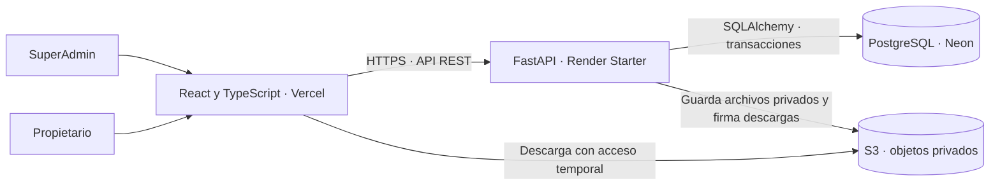
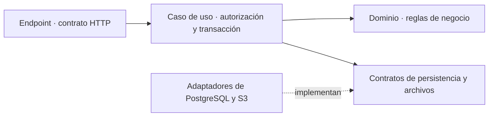
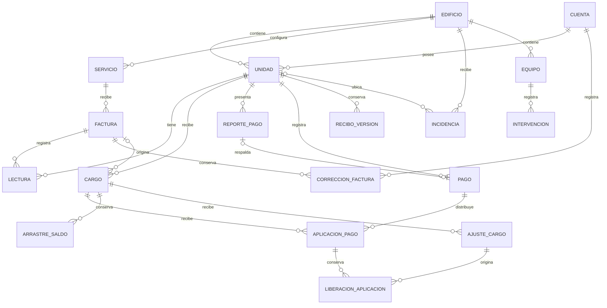

# Arquitectura

El diseño parte de un monolito modular. En una operación de pocos edificios, una sola API simplifica el despliegue y permite registrar la factura y sus cargos en la misma transacción. Los módulos separan las reglas de negocio de los detalles de HTTP, PostgreSQL y S3.

## Despliegue previsto

La API recibe las cargas, valida el alcance de cada operación y autoriza los enlaces temporales a S3. PostgreSQL conserva el estado del negocio y las referencias de los archivos. Cada entorno tendrá sus propias credenciales y datos. El esquema se gestiona con Alembic. [Configuración de archivos privados](archivos-s3.md)

## Responsabilidad de cada módulo

| Módulo | Responsabilidad |
| --- | --- |
| Identidad | Autenticar cuentas, gestionar credenciales y resolver el rol de la sesión. |
| Propiedades | Registrar edificios y unidades, asociar propietarios y administrar instrucciones de pago. |
| Facturación | Gestionar servicios, facturas y lecturas. Aplicar el reparto lineal o medido y emitir los cargos. |
| Cobranzas | Gestionar comprobantes, pagos confirmados, aplicaciones a cargos, créditos y arrastres. |
| Documentos | Emitir recibos PDF individuales, conservar su copia financiera y sus versiones, y autorizar descargas. |
| Reportes | Consultar estados de cuenta, consolidar datos y generar documentos a partir de importes registrados. |
| Incidencias | Registrar fallas y gestionar su atención dentro de cada edificio. |
| Mantenimiento | Gestionar equipos e intervenciones, y proyectar el calendario con la frecuencia de cada equipo. |

## Límites del backend

El caso de uso indica qué operación se ejecuta y dónde comienza y termina su transacción. Las estrategias de reparto trabajan con importes y lecturas. Los adaptadores traducen los resultados a operaciones de persistencia o almacenamiento. Las consultas simples pueden proyectar los datos que necesita la pantalla mediante su módulo.

El frontend se organiza por funcionalidad. OpenAPI será la referencia del contrato HTTP. El backend calcula importes y autoriza operaciones. La interfaz muestra resultados y errores de negocio.

## Inicio y cierre de sesión

La API comprueba las contraseñas con Argon2id. Al iniciar sesión genera un token aleatorio, guarda su huella en PostgreSQL y lo envía en una cookie `HttpOnly` y `SameSite=Strict`. La API comprueba el vencimiento, el estado de la cuenta y el rol en cada acceso protegido. Cerrar sesión elimina el registro y hace que la cookie anterior pierda validez.

El frontend accede a las rutas de sesión bajo el mismo origen. En desarrollo Vite actúa como proxy de `/api`. Las operaciones de inicio y cierre requieren una cabecera de la aplicación para rechazar envíos de formularios externos. En el despliegue, `/api` se servirá bajo el mismo origen HTTPS que el frontend.

## Capacidad y propietarios

El alta de una unidad y el cambio de capacidad bloquean la misma fila del edificio antes de contar las unidades. Así, el segundo cambio espera al primero y comprueba el padrón actualizado. PostgreSQL también exige que el número de unidad sea único dentro de cada edificio.

Cada unidad referencia una cuenta de Propietario. Si se crea la cuenta al registrar la unidad, los dos registros se confirman en la misma transacción. Las ediciones del nombre, usuario y datos de contacto se reflejan en las unidades que comparten esa cuenta.

«Mis propiedades» consulta las unidades de la cuenta autenticada. El listado devuelve los datos generales agrupados por edificio. La ficha agrega las instrucciones de pago de ese edificio. Tanto el listado como la ficha filtran por titular en la consulta a la base. Una unidad ajena y un identificador inexistente devuelven la misma respuesta.

## Modelo de datos conceptual

Las relaciones muestran el diseño previsto. Cada servicio pertenece a un edificio, y los equipos dependen de ese mismo límite. Una incidencia de área común pertenece al edificio y puede registrarse sin una unidad como ubicación. Un pago registrado por administración puede existir sin un reporte previo. Un cargo puede surgir de una factura o de un ajuste contable. Las tablas y restricciones definitivas quedarán en las primeras migraciones.

## Crédito automático y arrastres

Facturación llama a la conciliación de cobranzas después de registrar los cargos y antes de confirmar la transacción. Cobranzas usa el mismo bloqueo del edificio al confirmar pagos y reportes. El crédito disponible se consume dentro de la unidad por orden de registro del pago y antigüedad del cargo. Las aplicaciones conservan fecha, responsable y uso automático.

`balance_carry_forwards` registra una constancia por cargo y periodo posterior con actividad. El saldo total se calcula con cargos y aplicaciones; las constancias preservan el historial del arrastre. El primer arrastre bloquea la factura de origen. La [decisión financiera](decisiones/0001-creditos-y-arrastres.md) detalla el contrato y su recuperación.

## Ajustes de cargos con movimientos

`charge_adjustments` conserva cada diferencia monetaria por cargo, con revisión, solicitud, motivo y responsable. Las aplicaciones de pago tienen identidad propia y `payment_application_releases` referencia cada aplicación y el ajuste que liberó dinero. El crédito regresa al pago de origen y se aplica mediante la conciliación de la unidad. Factura, lecturas y aplicaciones originales conservan sus importes.

Las consultas suman las diferencias de ajustes al cargo y restan las liberaciones de las aplicaciones. Los arrastres conservan su importe histórico. El caso de uso autoriza por edificio y confirma todos esos movimientos bajo el bloqueo del edificio. La [decisión de ajustes](decisiones/0002-ajustes-auditados-de-cargos.md) detalla las reglas y la migración.
