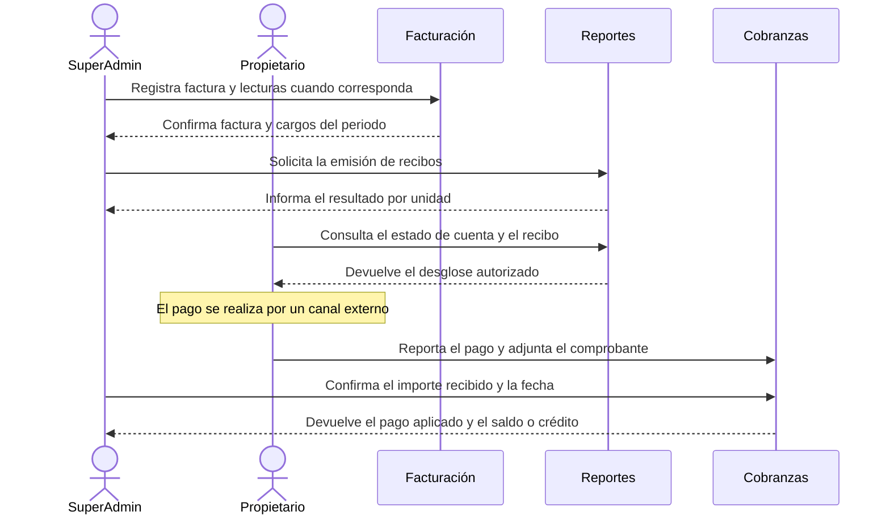

# Facturación y cobranza

La **factura de proveedor** registra el importe de origen. El **cargo** indica cuánto le corresponde a una unidad. El **recibo** es el documento emitido para un periodo. Un **comprobante** respalda el pago externo, y su confirmación permite aplicarlo a los cargos.

## Flujo de un periodo

## Reparto de la factura

- **Lineal.** Divide el monto entre las unidades participantes. Si quedan céntimos por distribuir, aplica un orden estable. Una factura de S/ 100,00 repartida entre tres unidades puede generar cargos de S/ 33,34, S/ 33,33 y S/ 33,33. Queda por definir cuál unidad recibe el céntimo adicional.
- **Medido.** Toma la lectura previa de la unidad para ese servicio y periodo. Calcula el consumo propio a partir de las lecturas y distribuye el volumen restante como consumo común. Las lecturas conservan tres decimales. Un reinicio del contador requiere confirmación.
- **Cuadre.** La factura y los cargos se registran como una sola operación. Si las lecturas suman 120 y la factura declara un volumen de 100, se deben corregir los datos antes de emitir cargos. La suma final de los cargos debe coincidir al céntimo con el importe de la factura.

## Aplicación de pagos

| Situación | Resultado esperado |
| --- | --- |
| Se adjunta un comprobante | Queda disponible para revisión. El saldo cambia cuando se confirma el pago. |
| El pago coincide con el saldo | Se aplica el pago a los cargos correspondientes y el saldo queda en cero. |
| El pago es parcial | Se registra el importe efectivamente recibido y queda un saldo. Un abono de S/ 10,00 sobre dos cargos de S/ 50,00 deja S/ 90,00 de saldo, con aplicaciones de pago no negativas. |
| El pago excede el saldo | Se cubre el saldo y se registra un crédito por la diferencia. |
| Se arrastra un saldo | El movimiento conserva el vínculo con el cargo y el periodo de origen. El cambio de diciembre a enero conserva ese vínculo. |
| Se repite una confirmación | La misma operación tiene un solo efecto, incluso ante solicitudes concurrentes. |

## Correcciones y recibos

Un cargo abierto puede corregirse conforme a las reglas de facturación. Si el importe ya fue liquidado o trasladado, el ajuste debe quedar vinculado al movimiento original. El estado de cuenta y las exportaciones se reconcilian con esos movimientos. Si se vuelve a emitir un recibo, queda una versión nueva del documento con los datos de emisión del periodo.

Antes de implementar la cobranza se decidirá cómo se ordenan los cargos para aplicar un pago parcial y cuándo trasladar saldos si se omite un mes. El flujo de corrección de periodos liquidados y los datos del Excel de transparencia también quedan pendientes de definición.
