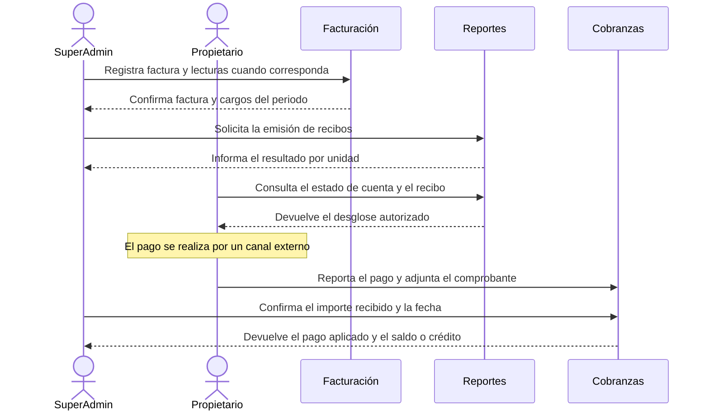

# Facturación y cobranza

La **factura de proveedor** registra el importe de origen. El **cargo** indica cuánto le corresponde a una unidad. El **recibo** es el documento emitido para un periodo. Un **comprobante** respalda el pago externo, y su confirmación permite aplicarlo a los cargos.

Cada edificio mantiene su propio catálogo de servicios. Al registrar uno se indica su nombre y el reparto lineal o por consumo medido. PostgreSQL comprueba la unicidad dentro del edificio comparando los nombres en minúsculas.

## Flujo de un periodo

## Reparto de la factura

- **Lineal.** Divide el importe en céntimos enteros entre las unidades registradas al emitir la factura. Los primeros números de unidad, ordenados como texto sin distinguir mayúsculas, reciben un céntimo adicional hasta agotar el residuo. Si hay empate en ese orden, decide el identificador de la unidad. Por ejemplo, S/ 100,00 entre 001, 002 y 003 genera S/ 33,34, S/ 33,33 y S/ 33,33, respectivamente. Si hay menos céntimos que unidades, se registra un cargo de S/ 0,00 para cada unidad a la que no le corresponde un céntimo.
- **Medido.** Usa la última lectura anterior del mismo servicio y unidad. La primera lectura anterior se puede introducir manualmente. Al registrar un periodo entre dos facturas existentes, las lecturas deben coincidir con los extremos ya registrados para conservar el historial. Si el contador vuelve a cero, el usuario lo confirma y el cálculo usa el ciclo de 100 000,000 m³. Las lecturas y los volúmenes se guardan con tres decimales.
- **Consumo común.** Resta la suma de consumos propios al volumen de la factura y reparte la diferencia en partes iguales. El monto se distribuye según los consumos propios y comunes. Los céntimos que quedan tras redondear hacia abajo se asignan a los importes con mayor residuo. En un empate, primero van los importes propios y luego los comunes, siguiendo el orden de unidad dentro de cada grupo.
- **Cuadre.** La factura y los cargos se registran como una sola operación. Si las lecturas suman 120 y la factura declara un volumen de 100, se deben corregir los datos antes de emitir cargos. La suma final de los cargos debe coincidir al céntimo con el importe de la factura.

PostgreSQL admite una sola factura por servicio y periodo contable. Cada cargo conserva el número de la unidad al emitirlo para que el historial siga mostrando el desglose original si cambia el padrón.

## Aplicación de pagos

| Situación | Resultado esperado |
| --- | --- |
| Se adjunta un comprobante | Queda disponible para revisión. El saldo cambia cuando se confirma el pago. |
| El pago coincide con el saldo | Se aplica el pago a los cargos correspondientes y el saldo queda en cero. |
| El pago es parcial | Se registra el importe efectivamente recibido y queda un saldo. Un abono de S/ 10,00 sobre dos cargos de S/ 50,00 deja S/ 90,00 de saldo, con aplicaciones de pago no negativas. |
| El pago excede el saldo | Se cubre el saldo y se registra un crédito por la diferencia. |
| Se arrastra un saldo | El movimiento conserva el vínculo con el cargo y el periodo de origen. El cambio de diciembre a enero conserva ese vínculo. |
| Se repite una confirmación | La misma operación tiene un solo efecto, incluso ante solicitudes concurrentes. |

## Correcciones y recibos

Un cargo abierto puede corregirse conforme a las reglas de facturación. Si el importe ya fue liquidado o trasladado, el ajuste debe quedar vinculado al movimiento original. El estado de cuenta y las exportaciones se reconcilian con esos movimientos. Si se vuelve a emitir un recibo, queda una versión nueva del documento con los datos de emisión del periodo.

Antes de implementar la cobranza se decidirá cómo se ordenan los cargos para aplicar un pago parcial y cuándo trasladar saldos si se omite un mes. El flujo de corrección de periodos liquidados y los datos del Excel de transparencia también quedan pendientes de definición.
