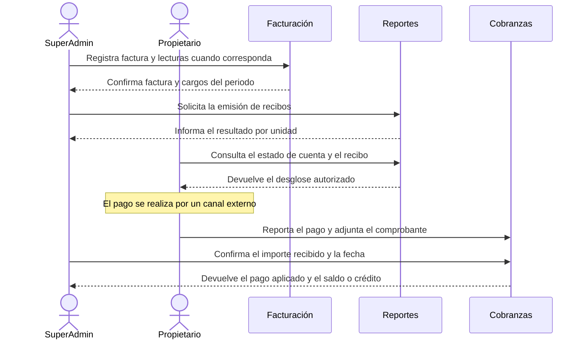

# Facturación y cobranza

La **factura de proveedor** registra el importe de origen. El **cargo** indica cuánto le corresponde a una unidad. El **recibo** es el documento emitido para un periodo. Un **comprobante** respalda el pago externo, y su confirmación permite aplicarlo a los cargos.

Cada edificio mantiene su propio catálogo de servicios. Al registrar uno se indica su nombre y el reparto lineal o por consumo medido. PostgreSQL comprueba la unicidad dentro del edificio comparando los nombres en minúsculas.

## Flujo de un periodo

## Reparto de la factura

- **Lineal.** Divide el importe en céntimos enteros entre las unidades registradas al emitir la factura. Los primeros números de unidad, ordenados como texto sin distinguir mayúsculas, reciben un céntimo adicional hasta agotar el residuo. Si hay empate en ese orden, decide el identificador de la unidad. Por ejemplo, S/ 100,00 entre 001, 002 y 003 genera S/ 33,34, S/ 33,33 y S/ 33,33, respectivamente. Si hay menos céntimos que unidades, se registra un cargo de S/ 0,00 para cada unidad a la que no le corresponde un céntimo.
- **Medido.** Usa la última lectura anterior del mismo servicio y unidad. La primera lectura anterior se puede introducir manualmente. Al registrar un periodo entre dos facturas existentes, las lecturas deben coincidir con los extremos ya registrados para conservar el historial. Si el contador vuelve a cero, el usuario lo confirma y el cálculo usa el ciclo de 100 000,000 m³. Las lecturas y los volúmenes se guardan con tres decimales.
- **Consumo común.** Resta la suma de consumos propios al volumen de la factura y reparte la diferencia en partes iguales. El monto se distribuye según los consumos propios y comunes. Los céntimos que quedan tras redondear hacia abajo se asignan a los importes con mayor residuo. En un empate, primero van los importes propios y luego los comunes, siguiendo el orden de unidad dentro de cada grupo.
- **Cuadre.** La factura y los cargos se registran como una sola operación. Si las lecturas suman 120 y la factura declara un volumen de 100, se deben corregir los datos antes de emitir cargos. La suma final de los cargos debe coincidir al céntimo con el importe de la factura.

PostgreSQL admite una sola factura por servicio y periodo contable. Cada cargo conserva el número de la unidad al emitirlo para que el historial siga mostrando el desglose original si cambia el padrón.

## Aplicación de pagos

Desde el estado de cuenta de la unidad, el SuperAdmin registra un pago recibido por un canal externo con su fecha, importe y referencia opcional. Indica el periodo de referencia del pago. El registro aplica primero a los cargos pendientes más antiguos de la unidad, incluidos los de años anteriores. Dentro del mes, ordena por fecha de fin de cobertura y usa el identificador de factura para desempatar.

El estado de cuenta muestra la deuda acumulada y el crédito por separado. El filtro mensual selecciona los cargos del mes, los pagos con ese periodo de referencia y los pagos anteriores aplicados a sus cargos. Al abrir un pago se ven sus aplicaciones, incluidas las que cubren periodos anteriores. El crédito queda registrado con el pago que lo generó y se aplica automáticamente al emitir o corregir facturas y al confirmar pagos. Se usan primero los créditos más antiguos por fecha de registro e identificador. Cada aplicación conserva cargo, fecha, responsable e indicación de uso automático. El saldo pertenece a la unidad, incluso si su propietario tiene otras propiedades.

El propietario puede enviar un reporte desde el estado de cuenta. Indica el periodo de referencia, la fecha y el importe del pago, y adjunta un comprobante. El SuperAdmin lo revisa desde «Reportes de pago» en el edificio. Al aprobar, confirma el importe y la fecha efectivamente recibidos. El reporte conserva los datos declarados y el identificador del pago generado. Al rechazar, el SuperAdmin registra un motivo visible para el propietario.

La aprobación aplica el pago y registra la decisión dentro de la misma transacción. Dos aprobaciones iguales producen un solo pago. Un reporte pendiente o rechazado deja el saldo tal como estaba.

Mientras el reporte esté pendiente, el SuperAdmin puede reemplazar el comprobante con una copia recibida por otro canal. Debe indicar el motivo del reemplazo. Cada versión conserva el archivo, la cuenta que lo subió, la fecha y el motivo. El propietario puede consultar ese historial desde su reporte y descargar el original o cualquiera de las copias.

La versión más reciente queda vigente para la revisión. Si otra sesión reemplaza el archivo, la API pide actualizar el reporte antes de aprobarlo o rechazarlo. Al terminar la revisión, el historial conserva la versión sobre la que se tomó la decisión.

PostgreSQL guarda el pago, sus aplicaciones y el bloqueo de las facturas afectadas en la misma transacción. Repetir la misma solicitud devuelve el pago registrado. Si la misma solicitud llega con otros datos, la API pide revisar el historial.

| Situación | Resultado esperado |
| --- | --- |
| Se adjunta un comprobante | Queda disponible para revisión. El saldo cambia cuando se confirma el pago. |
| El pago coincide con el saldo | Se aplica el pago a los cargos correspondientes y el saldo queda en cero. |
| El pago es parcial | Se registra el importe efectivamente recibido y queda un saldo. Un abono de S/ 10,00 sobre dos cargos de S/ 50,00 deja S/ 90,00 de saldo, con aplicaciones de pago no negativas. |
| El pago excede el saldo | Se cubre el saldo y se registra un crédito por la diferencia. |
| Se arrastra un saldo | El movimiento conserva el vínculo con el cargo y el periodo de origen. El cambio de diciembre a enero conserva ese vínculo. |
| Se repite una confirmación | La misma operación tiene un solo efecto, incluso ante solicitudes concurrentes. |

## Arrastre de saldos

Al abrir un periodo con una factura, el sistema conserva por cada cargo anterior pendiente su saldo, periodo de destino, fecha y responsable. El cargo mantiene su identidad y periodo de origen. El arrastre no agrega un segundo cargo al total de deuda. Los meses sin actividad se omiten y una factura fuera de orden puede registrar su saldo hacia periodos posteriores existentes.

El crédito se aplica antes de registrar nuevos arrastres. Una constancia ya registrada conserva su importe inicial aunque después se pague el cargo; el estado de cuenta muestra también su pendiente actual. Más servicios del mismo mes o solicitudes simultáneas conservan una sola constancia por cargo y periodo.

La [decisión de créditos y arrastres](decisiones/0001-creditos-y-arrastres.md) detalla el cambio del periodo de pago, los contratos y la migración.

## Correcciones y recibos

Desde la ficha de una factura abierta, el SuperAdmin puede corregir las fechas de cobertura y el importe. Para una factura medida también puede corregir el volumen y las lecturas compatibles con las facturas vecinas. La corrección conserva el servicio, el periodo contable, los adjuntos y las unidades de la emisión original. Los cargos mantienen su identidad y se recalculan al céntimo dentro de la misma transacción.

Cada cambio guarda la versión anterior y la nueva, junto con el motivo, la cuenta y la fecha. Si la factura cambió mientras estaba abierta en otra sesión, la API rechaza el guardado y pide recargar la ficha.

La primera aplicación de un pago marca su factura dentro de la misma transacción. Así, la API protege los cargos de esa factura ante una corrección directa. El primer arrastre también marca la factura y conserva ese mismo bloqueo. Cuando un cargo tiene esos movimientos, el SuperAdmin registra el nuevo importe y su motivo desde «Ajustar un cargo». La diferencia queda vinculada al cargo original, con revisión, fecha y responsable. El importe del proveedor y las lecturas se conservan. La ficha muestra también el total vigente de cargos. El estado de cuenta y las exportaciones se reconciliarán con esos movimientos. Regenerar un recibo crea una nueva versión con los datos de emisión del periodo.

Las reducciones liberan exclusivamente el dinero aplicado que excede el nuevo importe. Esa liberación conserva la aplicación anterior y devuelve crédito a su pago de origen. Se liberan primero las aplicaciones más recientes. El crédito vuelve a cubrir automáticamente pendientes de la misma unidad. La suma de aplicaciones vigentes y crédito disponible reconcilia con cada pago recibido. Los aumentos consumen crédito disponible o incrementan el pendiente.

La [decisión de ajustes auditados](decisiones/0002-ajustes-auditados-de-cargos.md) documenta el contrato y la recuperación de la migración.

## Excel de transparencia

Ambos roles descargan el Excel por unidad y periodo desde el estado de cuenta. Incluye resumen, cargos, reparto, pagos y ajustes. Los datos individuales corresponden a esa unidad; los agregados de la factura permiten comprobar el reparto del proveedor sin incluir registros de otros propietarios.

Los importes reflejan los movimientos vigentes al descargar. El pendiente suma el periodo elegido y los saldos anteriores una sola vez. Los cargos posteriores quedan fuera de ese total; las aplicaciones posteriores aparecen en Pagos para conciliar lo recibido con el crédito actual. El archivo conserva los cargos originales y explica aparte sus ajustes y diferencias de redondeo. La [decisión del Excel](decisiones/0005-excel-de-transparencia.md) define columnas, permisos, fórmulas y operación.

## PDF consolidado mensual

Desde Cobranzas, el SuperAdmin descarga el reporte de un edificio y periodo con cargos. Incluye las facturas del proveedor y los importes vigentes por servicio, además de cargos, aplicaciones netas, saldos anteriores, pendiente, vencido y crédito por unidad. El selector del PDF define su periodo; los filtros de la lista de cobranzas no reducen el documento.

El consolidado refleja movimientos vigentes al descargar, con el mismo alcance temporal del Excel por unidad. El crédito se muestra separado y los arrastres no duplican la deuda. Las unidades sin cargos del mes también aparecen. La [decisión del consolidado](decisiones/0006-pdf-consolidado-mensual.md) define cálculos, acceso administrativo y consistencia. La descarga es directa y no utiliza S3 ni crea una versión de recibo.

## Recibos por lote

Desde Cobranzas, el SuperAdmin prepara un lote con periodo, vencimiento común y motivo. La selección de unidades queda guardada. Cada unidad con cargos genera una versión nueva del recibo; las que no tienen cargos se identifican como omitidas. El resultado individual conserva lo emitido y permite continuar pendientes o reintentar fallos recuperables desde el historial.

Un reintento no regenera una unidad exitosa. Si cambian el vencimiento o la versión individual antes de emitir una unidad pendiente, el resultado informa el conflicto y pide preparar otro lote. Cada PDF refleja el estado financiero de su momento de emisión. La [decisión de lotes](decisiones/0007-recibos-por-lote.md) define persistencia, transacciones, recuperación y operación de la migración 0016.
