# Verificación

La verificación empieza con datos ficticios de dos edificios. Un propietario tiene una unidad en cada edificio y otro tiene una sola unidad. El SuperAdmin puede administrar ambos. Esta distribución permite comprobar el alcance de consultas, pagos, documentos y adjuntos.

## Recorrido de la interfaz reorganizada

La [organización visual](interfaz.md) retoma la paleta, tipografía y distribución del sistema anterior. Verifiqué el cambio localmente el 18 de noviembre de 2026 con datos sintéticos y PostgreSQL aislado.

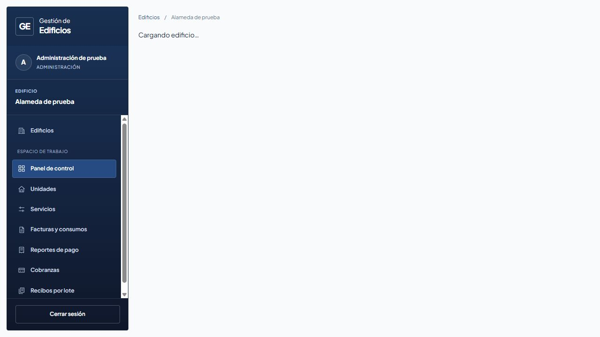

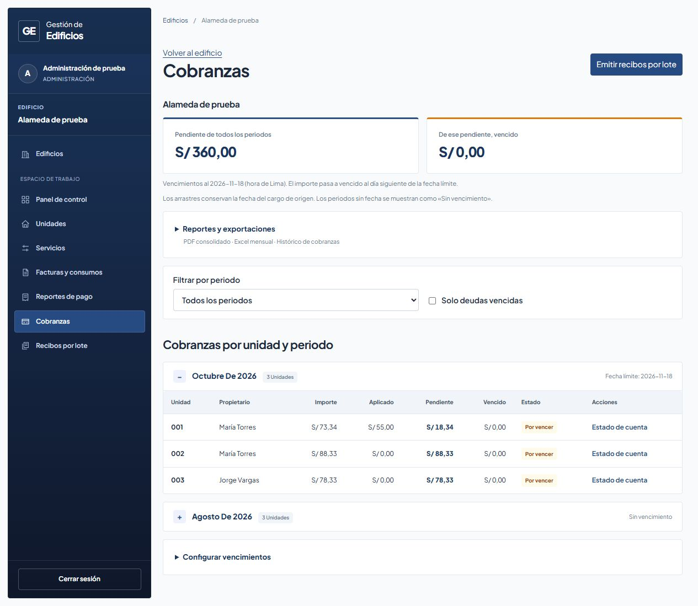

Entré como SuperAdmin y recorrí edificios, panel, unidades, servicios, facturas, reportes de pago, cobranzas y recibos por lote desde la barra lateral. El contexto mostró el edificio seleccionado y el foco pasó al contenido al cambiar de ruta. Busqué una propietaria en Unidades y abrí su ficha. Abrí con teclado el alta de factura, las exportaciones y la configuración de vencimientos.

En Cobranzas comprobé el pendiente global de 360.00 y las filas de octubre y agosto. El filtro de agosto conservó los importes 95.00, 100.00 y 100.00, con pendientes 0.00, 75.00 y 100.00. «Solo deudas vencidas» mostró el estado vacío correspondiente a la fecha de prueba. Descargué el PDF consolidado, el Excel mensual y el histórico desde la sección agrupada; los tres archivos se materializaron. Sus generadores y las reglas contables no cambiaron.

Una demora sintética mostró la carga; un fallo de consulta mostró el error y «Volver a intentar» recuperó las tablas. Un edificio sin cargos mostró el vacío. En 390 × 844, el documento no tuvo desbordamiento horizontal: la tabla se desplazó dentro de su región. El menú móvil cerró con Escape y al navegar; Escape devolvió el foco al botón y restauró el desplazamiento del documento. Pasar a escritorio con el menú abierto también lo cerró.

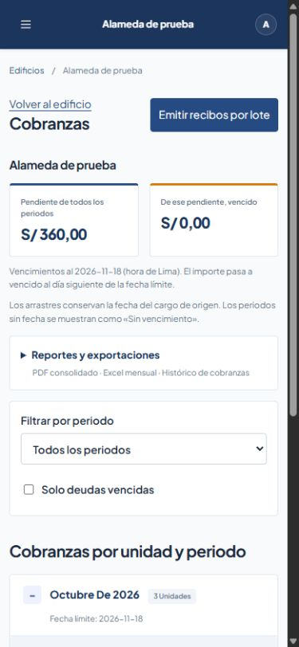

Entré con dos propietarios. Una cuenta vio sus dos unidades de un edificio y otra de un segundo edificio con 7.03 de crédito; la otra vio solamente su unidad. Abrí Mi unidad y Estado de cuenta y recibos, y confirmé el contexto de la propiedad. Las rutas de unidades ajenas mostraron «No se encontró la unidad» sin revelar su nombre; una ruta administrativa redirigió al portal del propietario.

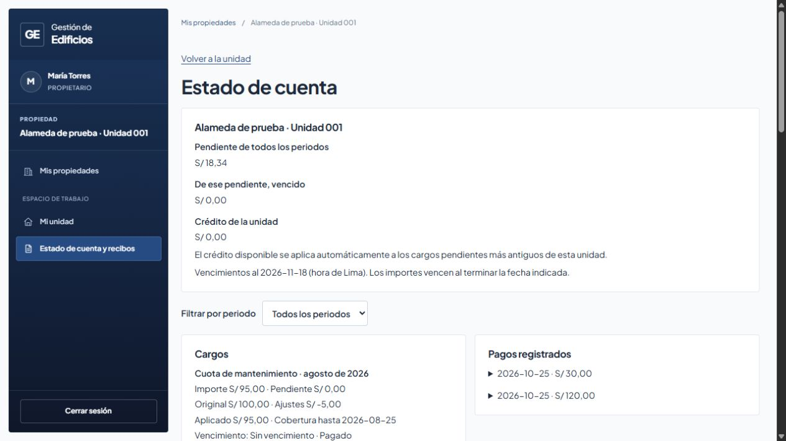

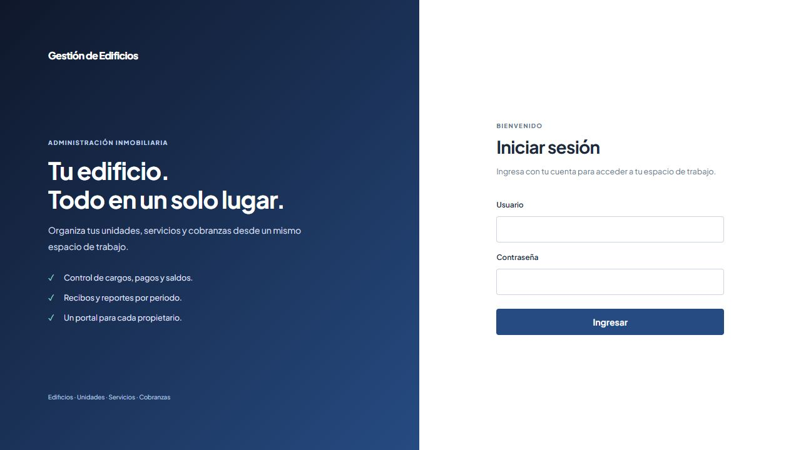

`npm run build` pasó con TypeScript y Vite; `git diff --check` no detectó errores. Esta entrega cambia el frontend y no vuelve a ejecutar la suite del backend. La verificación descrita es local; falta el recorrido del diseño en el entorno desplegado. No se aplicaron migraciones ni cambios en Neon o S3.

## Escenarios de aceptación previstos

| Prueba | Requisitos | Resultado esperado |
| --- | --- | --- |
| Sesión | IDE-01 | Cada rol llega a su panel. El cierre o vencimiento de sesión retira el acceso y la API rechaza el acceso con el rol equivocado. |
| Perfil | IDE-02 | Una contraseña de confirmación incorrecta conserva los datos anteriores. |
| Alta y configuración de un edificio | EDI-01 | El SuperAdmin crea, abre y edita un edificio. Al recargar, persisten los datos generales e instrucciones de pago. La API rechaza una capacidad negativa y bloquea el acceso de propietarios. |
| Alta simultánea de unidades | UNI-01, UNI-02 | Con una plaza disponible, una sola alta se confirma. El número se mantiene único por edificio y la búsqueda encuentra la ficha por unidad o propietario. |
| Factura lineal de S/ 100,00 entre tres unidades | FAC-01, FAC-02, FAC-03 | Se crean tres cargos cuya suma es S/ 100,00. Un segundo registro para el mismo servicio y periodo se rechaza. |
| Factura medida y reinicio del contador | FAC-02, FAC-03 | Se carga la última lectura de ese servicio. El reinicio confirmado conserva la precisión. Con consumo de 120 y volumen declarado de 100, la factura y sus cargos quedan sin registrar. |
| Corrección de una factura | FAC-02, FAC-03 | Se conserva el padrón original, el importe cuadra y la revisión deja constancia del cambio. Una revisión desactualizada, una lectura incompatible o una factura con movimientos impiden el guardado. |
| Pago parcial y cambio de año | COB-01, COB-02 | Un pago de S/ 10,00 sobre S/ 100,00 deja S/ 90,00 de saldo. El arrastre de diciembre a enero referencia su origen. Verificar también pago exacto y excedente. |
| Confirmación simultánea de un pago | COB-02 | Dos intentos de confirmar la misma operación generan un solo pago y un solo conjunto de aplicaciones. La prueba consulta el estado persistido. |
| Acceso a datos y archivos | POR-01, DOC-01, ARC-01 | El propietario con dos unidades puede consultar ambas. El otro solo accede a la suya. Los documentos y enlaces temporales siguen el mismo alcance y caducan cuando corresponde. |
| Reportes y emisión por lote | DOC-01, DOC-02 | El PDF y los Excel reflejan el periodo correcto y sus totales cuadran. El resultado identifica un fallo parcial y permite reintentar esa unidad. Regenerar conserva la versión emitida. |
| Incidencia de área común | INC-01, ARC-01 | El propietario adjunta una foto opcional. El SuperAdmin encuentra el reporte por edificio y estado, lo abre y lo marca como atendido. |
| Corregir la última intervención | MAN-01, MAN-02 | Editar o eliminar la última intervención actualiza la próxima fecha en catálogo y calendario. Una frecuencia mensual al fin de mes produce la misma fecha en ambas vistas. |

## Dónde ejecutar cada prueba

- **Dominio.** Usar pruebas unitarias para prorrateos, lecturas, aplicación de pagos, cambio de periodo y recurrencias.
- **Integración.** Usar una base PostgreSQL aislada para comprobar transacciones, migraciones, alcance por edificio y concurrencia. Verificar el contrato HTTP de los dos roles.
- **Navegador y documentos.** Recorrer alta, facturación, consulta, reporte y validación de pago desde la interfaz. Revisar PDF y Excel con los datos sintéticos y comprobar los flujos de incidencias y equipos.
- **Demo.** Preparar la base desde las migraciones y comprobar que la carga y descarga de archivos funciona con acceso temporal. Revisar teclado, foco, pantallas estrechas y estados de carga, vacío y error. Ante un fallo de la API, buscar su identificador de solicitud en los logs y comprobar que no se expongan credenciales.

Las pruebas y sus resultados se enlazarán desde la [matriz de paridad](paridad.md) a medida que se implementen los requisitos.

## Recorrido con Neon y S3

El 17 de noviembre de 2026 comprobé el frontend y la API ejecutados localmente con PostgreSQL en Neon y archivos privados en Amazon S3. El recorrido usó datos ficticios de dos edificios, tres unidades y dos propietarios.

Desde la interfaz registré el padrón, un servicio lineal y una factura de S/ 100,00 para dos unidades. Se guardaron y descargaron el documento del proveedor y su comprobante. La comparación del contenido confirmó que las descargas correspondían a los archivos cargados.

El propietario envió un reporte de S/ 10,00 y otro de S/ 5,00. El primero recibió una copia legible del comprobante y se aprobó por el importe verificado de S/ 12,00. El segundo se rechazó con un motivo. El cargo de la primera unidad quedó con S/ 38,00 pendientes. El historial conservó el original y la copia, y se pudo descargar cada versión desde ambos roles.

Una descarga sin firma respondió `403`. El segundo propietario recibió `404` al solicitar el estado de cuenta y la copia del comprobante de la unidad ajena. Su propia unidad conservó S/ 50,00 pendientes. El despliegue del frontend en Vercel y de la API en Render requiere una verificación posterior.

## Recorrido de identidad

Completar el arranque descrito en el [README](../README.md#desarrollo-local) y usar las dos cuentas de prueba.

1. Abrir `/admin` antes de iniciar sesión. Debe aparecer el formulario de acceso. Probar una contraseña incorrecta y luego entrar como SuperAdmin. Al recargar, el panel permanece abierto.
2. Cerrar sesión e intentar volver a `/admin`. Debe aparecer el formulario.
3. Entrar como Propietario y abrir `/admin`. El navegador vuelve a «Mis propiedades» y una solicitud a `/api/admin/session` devuelve `403`.
4. Comprobar el acceso con una sesión vencida mediante la [suite de API](../backend/tests/test_identity.py). También puede comprobarse en una base aislada fijando una fecha de vencimiento pasada en la sesión de prueba y recargando el panel. La aplicación debe volver al inicio de sesión.

## Recorrido de edificios

1. Entrar como SuperAdmin. En una base vacía, se muestra el listado vacío y el enlace «Nuevo edificio».
2. Registrar un edificio con capacidad y datos de pago ficticios. Abrir la ficha y confirmar que los campos de cuenta y CCI conservan sus ceros iniciales. Editar la capacidad, borrar un dato opcional y recargar la ficha para confirmar los cambios.
3. Volver al listado y abrir el edificio por nombre. Tras cerrar sesión y entrar como Propietario, abrir la dirección de la ficha. El navegador debe volver a «Mis propiedades» y la API debe devolver `403`.

## Recorrido de unidades y propietarios

1. Crear dos edificios con capacidad de una unidad. Abrir el padrón del primero y registrar una unidad con una cuenta de propietario nueva.
2. Registrar otra unidad en el segundo edificio seleccionando la cuenta anterior. Se puede usar el mismo número porque corresponde a otro edificio.
3. Editar el número y el área físicos de una unidad. Editar el nombre del propietario desde la otra y comprobar que el cambio se muestra en ambos edificios. Buscar por número, nombre o usuario.
4. Intentar reducir a cero la capacidad de un edificio ocupado. El sistema debe rechazar el cambio y conservar la capacidad registrada. Las [pruebas con PostgreSQL](../backend/tests/test_units.py) también ejecutan dos altas para la última plaza y un alta en paralelo con una reducción de capacidad. Solo una operación se confirma en cada caso.

## Recorrido de Mis propiedades

1. Entrar con una cuenta de propietario sin unidades. Comprobar el mensaje de lista vacía.
2. Desde administración, asignarle unidades en dos edificios. Asociar otra unidad del mismo edificio a un segundo propietario.
3. Volver a iniciar sesión con la primera cuenta. Abrir cada grupo de «Mis propiedades» y comprobar su unidad, área, edificio, dirección e instrucciones de pago. Si el edificio aún no tiene instrucciones configuradas, la ficha lo indica.
4. Abrir la dirección de la unidad ajena. El portal muestra «No se encontró la unidad» y la API responde `404`. Al iniciar sesión como el segundo propietario, este puede abrir su propia ficha.

## Recorrido del catálogo de servicios

1. Como SuperAdmin, abrir «Servicios» desde la ficha de un edificio. Comprobar el mensaje de catálogo vacío.
2. Crear un servicio lineal y uno por consumo medido. Recargar y comprobar el nombre y tipo de reparto de ambos.
3. Intentar registrar el mismo nombre cambiando las mayúsculas. El catálogo rechaza el duplicado. Abrir otro edificio y comprobar que su catálogo admite ese nombre.
4. Iniciar sesión como Propietario. Las rutas de consulta y alta del catálogo administrativo devuelven `403`.

## Recorrido de facturación lineal

1. Como SuperAdmin, abrir «Facturas» en un edificio con las unidades 001, 002 y 003 y un servicio lineal.
2. Registrar una factura de S/ 100,00. Su ficha debe mostrar S/ 33,34 para 001 y S/ 33,33 para cada una de las otras unidades. Recargar y comprobar el mismo desglose.
3. Volver al historial e intentar registrar otra factura del mismo servicio y periodo. La API devuelve `409` y el historial conserva una sola factura para ese periodo.
4. En [las pruebas de integración](../backend/tests/test_linear_invoices.py), verificar el estado persistido ante dos altas simultáneas y ante un fallo al guardar los cargos. El fallo revierte tanto la factura como sus cargos.

## Recorrido de facturación por consumo medido

1. Seleccionar un servicio medido, mes y año para cargar una lectura por unidad. En un periodo sin historial se puede indicar la lectura anterior.
2. Intentar guardar consumos individuales de 60,000 m³ para dos unidades con un volumen de factura de 100,000 m³. La API debe rechazar la factura y conservar el historial sin cambios.
3. Registrar S/ 100,00 por 30,000 m³, con consumos propios de 10,000 y 5,000 m³. El volumen común es 15,000 m³ y los cargos son S/ 58,33 y S/ 41,67.
4. Abrir el periodo siguiente y comprobar que se precarga la lectura anterior del servicio correcto. Una lectura actual menor exige confirmar la vuelta a cero. Al abrir la ficha, se muestran la lectura anterior, la actual y el desglose de consumos.

## Recorrido de corrección de facturas

1. Abrir la ficha de una factura lineal con tres unidades, elegir «Corregir factura» y guardar S/ 100,01 con un motivo. Los cargos suman exactamente S/ 100,01. La ficha conserva sus adjuntos y muestra el motivo en «Correcciones».
2. Abrir la misma factura en dos pestañas. Guardar un cambio en una y luego intentar guardar en la otra. La API devuelve `409` a la segunda. Recargar la ficha y comprobar que muestra la corrección que se guardó.
3. En una factura medida con un periodo posterior registrado, intentar cambiar una lectura final que se usa en la siguiente factura. La API rechaza el cambio. Corregir el monto o un volumen que cubra el consumo y comprobar que se actualiza el reparto.
4. La [suite con PostgreSQL](../backend/tests/test_invoice_corrections.py) comprueba que una factura marcada con movimientos conserva sus cargos y su historial ante un intento de edición directa.

## Recorrido de registro de pagos

1. Registrar dos facturas de S/ 50,00 para una misma unidad en diciembre y enero. Como SuperAdmin, abrir la unidad y elegir «Estado de cuenta». Debe mostrar S/ 100,00 pendientes.
2. Registrar S/ 10,00 con fecha de recepción y enero como mes de aplicación. Deben quedar S/ 90,00 pendientes. Al abrir el detalle del pago se ve una aplicación de S/ 10,00 al cargo de diciembre. El periodo indicado queda como referencia del pago.
3. Registrar S/ 95,00 con el mismo mes de aplicación. El detalle muestra S/ 40,00 aplicados a diciembre y S/ 50,00 a enero, con S/ 5,00 de crédito. Repetir con la misma clave de solicitud debe conservar un solo pago de S/ 95,00.
4. Iniciar sesión como Propietario y entrar al estado de cuenta de la unidad. Comprobar el filtro de periodo, el crédito y el detalle de las aplicaciones. Una unidad ajena devuelve `404`. El [contrato y los efectos persistidos](../backend/tests/test_collections.py) se comprueban con PostgreSQL.

## Recorrido de reportes de pago

1. Como Propietario, enviar un reporte con un PDF desde el estado de cuenta. Debe aparecer como «Pendiente de revisión» y el total pendiente conserva su importe.
2. Como SuperAdmin, abrir «Reportes de pago» desde el edificio y descargar el comprobante. Aprobar indicando el importe efectivamente recibido. Al repetir la misma aprobación, el estado de cuenta debe mostrar un solo pago.
3. Enviar otro reporte y rechazarlo con un motivo. El propietario debe ver el motivo en su historial y la deuda debe reflejar solo el pago aprobado.
4. Las [pruebas de API](../backend/tests/test_collections.py) verifican acceso por titular y edificio, formatos, tamaño, reintento tras error de almacenamiento y enlace temporal. El recorrido local usa un adaptador de prueba. La validación con el bucket está en la [guía de S3](archivos-s3.md).

## Recorrido de reemplazo de comprobantes

1. En un reporte pendiente, descargar el original y guardar una copia nueva con un motivo. Abrir de nuevo el reporte. El historial debe mostrar el original, la copia vigente, la cuenta y la fecha de cada carga, junto con el motivo del reemplazo.
2. Descargar ambas versiones y comprobar que cada una corresponde a su archivo. Iniciar sesión como el propietario que envió el reporte y comprobar el mismo historial.
3. Abrir el reporte en dos sesiones. Reemplazar el archivo desde una e intentar aprobar desde la otra. La API debe devolver `409` y pedir actualizar el reporte.
4. Actualizar la bandeja, revisar la versión vigente y aprobar. El pago se aplica una sola vez y el historial del comprobante sigue disponible. Las [pruebas de integración](../backend/tests/test_collections.py) también verifican permisos, reintentos y recuperación tras un error de almacenamiento.

## Recorrido de crédito automático y arrastres

El 17 de noviembre de 2026 comprobé este cambio con PostgreSQL 17 aislado. La suite completa pasó con 98 pruebas. Ruff, formato, TypeScript, compilación y `alembic check` forman parte de la validación local. La prueba de migración crea un esquema independiente en la revisión 0011 con un pago, crédito y aplicación existentes, comprueba su conservación al subir a 0012 y verifica la protección del rollback con arrastres.

Las pruebas concurrentes ejecutan emisión y pago sobre el mismo crédito, dos facturas de servicios distintos para el mismo periodo y dos confirmaciones del mismo pago. Comprueban los saldos persistidos y la unicidad de aplicaciones y arrastres. Otro caso fuerza un fallo después de conciliar y comprueba que la factura, el crédito y las constancias se revierten juntos.

El recorrido de navegador usó una API, un frontend y una base de pruebas independientes, con datos ficticios. Como SuperAdmin abrí una unidad con dos cargos de S/ 50,00 y un pago de S/ 70,00. El segundo cargo recibió automáticamente S/ 20,00 de crédito y mostró S/ 30,00 pendientes. Abrí el detalle del pago con Enter y comprobé la aplicación, su fecha y la cuenta que registró la operación.

Como segundo propietario abrí su propia unidad. El saldo de diciembre de S/ 50,00 quedó vinculado a febrero, omitiendo enero sin factura. El pendiente total fue S/ 100,00 por sus dos cargos. Seleccioné febrero con teclado y comprobé el cargo del mes junto con la constancia del saldo anterior. En una vista de 390 píxeles los bloques se apilaron y el contenido no desbordó horizontalmente.

Para reproducir el flujo:

1. Aplicar `alembic upgrade head` a una base de pruebas y crear dos unidades de propietarios diferentes.
2. Emitir diciembre con S/ 50,00 por unidad. Registrar S/ 70,00 en una de ellas: quedan S/ 20,00 de crédito.
3. Emitir febrero, sin factura en enero. La primera unidad queda con S/ 30,00 pendientes y crédito cero. La otra conserva S/ 100,00 pendientes y un arrastre de S/ 50,00 desde diciembre.
4. Consultar ambos estados de cuenta con sus propietarios. Cada uno debe ver solamente su unidad. En el filtro mensual, los pagos anteriores con aplicaciones al mes también quedan disponibles para consultar su detalle.
5. Registrar un pago sobre el saldo arrastrado. La constancia conserva el importe histórico y muestra el pendiente actual del cargo. La factura de origen sigue bloqueada para correcciones directas.

La conciliación y la protección entre dos propietarios también se verifican en API. La migración `0012_automatic_credit_and_carry` se aplicó a la base de demostración en Neon el 17 de noviembre de 2026. `alembic check` confirmó la correspondencia del esquema con los modelos. La base quedó con 17 tablas. La comparación de huellas antes y después conservó los registros de siete tablas financieras y comprobó la fecha y el responsable de las aplicaciones anteriores. El recorrido de interfaz de esta entrega usó PostgreSQL aislado; queda por repetirlo con Neon y comprobar el despliegue en Vercel y Render. Los objetos de S3 no se modificaron.

## Recorrido de ajustes auditados

El 17 de noviembre de 2026 verifiqué los ajustes con PostgreSQL 17 aislado y datos ficticios. Las pruebas de API cubren aumentos, reducciones a cero, pagos parciales, reintentos, revisiones antiguas, edificios ajenos y consultas de dos propietarios. Un cargo pagado de S/ 100,00 corregido a S/ 80,00 conserva su pago y genera S/ 20,00 de crédito. Si hay otros cargos pendientes de la unidad, ese dinero se aplica automáticamente.

La suite también comprueba reducciones y aumentos sucesivos sobre la misma aplicación, la conservación de lecturas y arrastres, y el rollback ante un fallo después de conciliar. Las pruebas concurrentes ejecutan dos ajustes iguales, dos revisiones en conflicto y un ajuste simultáneo a un pago. La prueba de migración conserva los valores de una aplicación existente al asignarle identidad y verifica la protección del descenso con historial de ajustes y liberaciones.

Desde el navegador entré como SuperAdmin, abrí una factura de S/ 200,00 para dos unidades y ajusté el cargo pagado de la primera de S/ 100,00 a S/ 80,00, indicando el motivo. Guardé con teclado y comprobé el historial y el total vigente de S/ 180,00. Después registré S/ 95,00 como nuevo importe: la factura conservó S/ 200,00 originales, el total vigente pasó a S/ 195,00 y el foco llegó al aviso de confirmación.

Como propietario de la primera unidad, consulté S/ 95,00 aplicados y S/ 5,00 de crédito disponible. El detalle conservó la aplicación inicial de S/ 100,00, su liberación de S/ 20,00 y una nueva aplicación automática de S/ 15,00. El historial mostró los dos ajustes con su motivo, fecha y responsable. El formulario a 390 píxeles conservó sus controles, el foco visible y el contenido sin desbordamiento horizontal.

Para reproducir:

1. Aplicar `alembic upgrade head` en una base de pruebas. Emitir S/ 100,00 para una unidad y registrar un pago exacto.
2. Abrir la factura como SuperAdmin. Registrar S/ 80,00 y un motivo desde «Ajustar un cargo». Verificar S/ 20,00 de crédito y el cargo original de S/ 100,00.
3. Registrar S/ 95,00 como nuevo importe. Verificar otra entrada de historial, una nueva aplicación de S/ 15,00 y S/ 5,00 de crédito.
4. Entrar como propietario y consultar el estado de cuenta. Comprobar que otro propietario no accede a la unidad ni a sus ajustes.
5. En dos sesiones administrativas, intentar ajustar la misma revisión. Una operación se confirma y la otra pide actualizar la ficha. Reintentar la misma solicitud conserva un solo ajuste.

La suite completa pasó con 112 pruebas en PostgreSQL 17 aislado. Ruff, formato, TypeScript, compilación y `alembic check` fueron correctos. La migración 0013, los ajustes y sus liberaciones se verificaron localmente. Esta entrega no modificó Neon ni S3, ni ejecutó un despliegue o CI remoto.

## Recorrido del resumen de saldos

El 17 de noviembre de 2026 comprobé «Mis propiedades» con una API, un frontend y PostgreSQL 17 aislados. Cada unidad muestra el total pendiente de todos sus periodos, el crédito disponible y un enlace directo al estado de cuenta. Los importes se obtienen juntos en una sola consulta SQL, con el alcance del propietario autenticado. El contrato del listado añade `balance` y `credit` como cadenas decimales; la ficha individual conserva su contrato.

El cálculo comparte las aplicaciones netas y los ajustes del estado de cuenta. Los arrastres son constancias del cargo de origen y no vuelven a sumarse. El crédito permanece separado del pendiente; las operaciones contables ya aplican automáticamente el dinero disponible.

En el navegador consulté tres unidades de un propietario en dos edificios: una con S/ 5,00 de crédito tras un ajuste, otra con S/ 150,00 pendientes de diciembre y febrero, y una sin cargos con S/ 7,03 de crédito. Abrí el estado de cuenta con Enter y comprobé los mismos importes y el foco visible. El segundo propietario vio únicamente su unidad. Una cuenta sin unidades mostró el mensaje vacío y el SuperAdmin conservó su panel de edificios.

A 390 píxeles las tarjetas se apilaron sin desbordamiento horizontal; también revisé la presentación a 1280 píxeles. Al detener la API de pruebas y volver al listado apareció el error de carga. Tras reiniciarla, «Volver a intentar» recuperó el resumen mediante teclado.

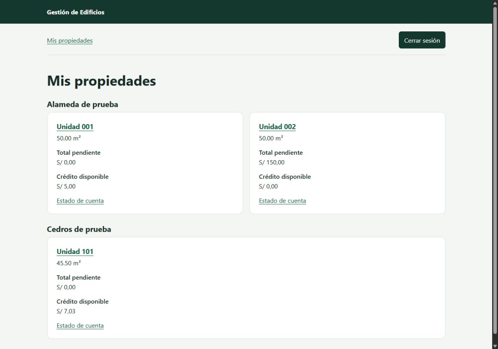

Para reproducir:

1. Crear dos edificios, un propietario con unidades en ambos y otro con una unidad en el edificio compartido.
2. Emitir diciembre y febrero, omitiendo enero. Registrar pagos parciales y excedentes, y ajustar un cargo pagado hacia abajo y después hacia arriba.
3. Consultar «Mis propiedades» con ambos propietarios. Comparar el pendiente y el crédito de cada tarjeta con su estado de cuenta, incluidos los céntimos y los arrastres.
4. Crear una unidad sin cargos y registrar un pago. El resumen debe mostrar pendiente cero y el importe recibido como crédito.
5. Recorrer los enlaces con Tab y Enter, revisar móvil y consultar con una cuenta sin unidades. Comprobar el aviso de error y el reintento ante una interrupción de la API de pruebas.

La [suite de propiedades](../backend/tests/test_owner_properties.py) verifica el alcance de dos propietarios, la conciliación con movimientos reales y una sola consulta para varias unidades. La suite completa pasó con **114 pruebas** mediante `pytest -q`, usando `TEST_DATABASE_URL` de PostgreSQL local aislado. `ruff check .`, `ruff format --check .`, `alembic check` y `npm run build` fueron correctos. No se requiere una migración nueva. La comprobación del entorno desplegado queda pendiente.

## Recorrido de vencimientos y cobranzas

El 17 de noviembre de 2026 comprobé la pantalla «Cobranzas» desde el edificio como SuperAdmin. La API, el frontend y PostgreSQL 17 fueron locales y aislados, con dos propietarios y datos ficticios. El edificio tenía S/ 300,00 pendientes entre agosto y octubre. Octubre vencía el mismo día de la consulta y aún mostraba «Por vencer». Agosto no tenía fecha y mostraba «Sin vencimiento».

Registré el 16 de noviembre como fecha límite de agosto y guardé con Enter. El aviso de confirmación recibió el foco y el resumen pasó a S/ 200,00 vencidos. Una segunda pestaña que conservaba la revisión anterior recibió un conflicto al guardar otra fecha. Registré después el 15 de noviembre desde la revisión vigente y comprobé que el historial conservaba ambas fechas, sus motivos y su autor. El formulario mantuvo seleccionado el periodo guardado.

«Solo deudas vencidas» mostró únicamente las dos unidades con S/ 100,00 pendientes en agosto. Al combinarlo con octubre, el listado quedó vacío; el resumen superior mantuvo sus totales rotulados para todos los periodos. También comprobé un edificio sin cargos y el aviso de error al detener la API sintética. Reiniciarla y pulsar «Volver a intentar» con teclado recuperó los datos.

Como propietario consulté una unidad con S/ 150,00 pendientes y S/ 100,00 vencidos. El cargo de agosto conservó su fecha, aunque tenía una constancia de arrastre a octubre; el cargo de octubre seguía por vencer. El segundo propietario vio solo su unidad, con los mismos criterios. A 390 píxeles el formulario, los filtros y el historial no desbordaron horizontalmente; también revisé la vista de escritorio a 1280 píxeles y el foco visible en «Guardar vencimiento».

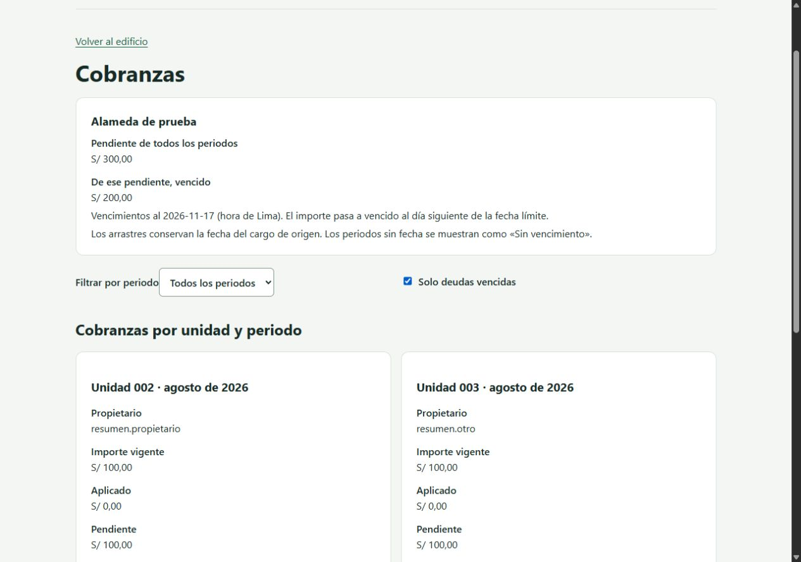

Para reproducir:

1. Aplicar `alembic upgrade head` en una base aislada. Crear dos propietarios, unidades en dos edificios y facturas en dos periodos, con más de un servicio en uno de ellos.
2. Abrir «Cobranzas» desde el edificio. Comprobar los importes pendientes y que los periodos anteriores no recibieron fechas automáticamente.
3. Registrar una fecha anterior al día de Lima para un periodo, con un motivo. Asignar el día actual al otro. Solo el primer periodo debe contar como vencido.
4. Combinar los filtros de periodo y deuda vencida. Abrir el estado de cuenta de una unidad y comparar el saldo vencido con su cobranza.
5. Registrar pagos parciales y ajustar un cargo con movimientos. Comprobar que el vencido usa el saldo actual, sin duplicar arrastres ni restar el crédito dos veces.
6. Guardar desde dos pestañas con la misma revisión. Una debe pedir actualizar; repetir una solicitud confirmada conserva un solo registro. Cambiar la fecha desde la revisión vigente conserva el historial.

La suite completa pasó con **125 pruebas** en PostgreSQL 17 aislado mediante `pytest -q`. Ruff, formato, `alembic check`, TypeScript y compilación fueron correctos. La prueba de migración sube desde 0013 con factura, cargo, pago, aplicación y arrastre; compara siete tablas financieras, comprueba la ausencia de fechas inventadas y bloquea el descenso con historial. Las pruebas concurrentes verifican reintentos iguales y cambios en conflicto. La [decisión de vencimientos](decisiones/0003-vencimientos-por-periodo.md) describe la regla, los contratos y la recuperación.

La migración `0014_collection_deadlines` se aplicó a Neon el 17 de noviembre de 2026 desde 0013. Las huellas anteriores y posteriores coincidieron en trece tablas financieras, incluidos cargos, lecturas, pagos, aplicaciones, ajustes, arrastres y metadatos de archivos. La base quedó con veinte tablas y ningún vencimiento creado automáticamente. `alembic check` no detectó diferencias entre el esquema y los modelos. El recorrido de interfaz descrito arriba fue local y aislado; quedan pendientes la comprobación de vencimientos con Neon y el despliegue conjunto de backend y frontend.

## Recorrido de recibos PDF individuales

El 18 de noviembre de 2026 verifiqué la emisión desde el estado de cuenta de una unidad como SuperAdmin. La API, el frontend, PostgreSQL 17 y el almacenamiento de archivos fueron aislados, con datos ficticios. El recibo de octubre incluyó S/ 88,33 de cargos del mes, S/ 75,00 anteriores pendientes y S/ 163,33 totales. El detalle de agua mostró las lecturas 10,000 y 12,500 m³, el consumo propio de 2,500 m³ y su componente común original. Un abono recibido de S/ 25,00 apareció aplicado a los cargos anteriores.

Guardé con Enter y el foco llegó a la confirmación. Emití una segunda versión con otro motivo y comprobé que ambas seguían disponibles. Un fallo sintético al guardar otro periodo mostró el error de almacenamiento; el reintento con los mismos datos produjo una sola primera versión. A 390 píxeles se conservaron enlaces, campos y foco visible sin desbordamiento horizontal.

Como propietario consulté las dos versiones de su unidad. La descarga del administrador y la del propietario validaron el acceso, redirigieron al archivo y obtuvieron respuesta `200` del almacenamiento de prueba. El segundo propietario vio el historial vacío de su propia unidad. Las pruebas de API comprueban además que no puede listar ni descargar los recibos de la otra cuenta o combinar un recibo con otra unidad o edificio.

Rendericé el PDF emitido con Poppler y revisé sus dos páginas: cabecera, importe destacado, cargos, saldos anteriores, pagos, instrucciones, versión y numeración. La huella del archivo coincidió con el registro persistido. Un caso adicional de cuatro páginas verificó nombres largos, acentos, importes altos, repetición de cabeceras y saltos de página sin solapamientos.

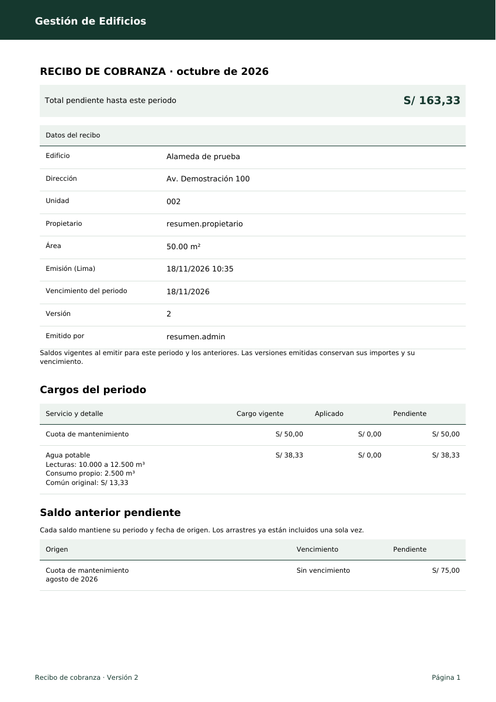

Para reproducir:

1. Aplicar `alembic upgrade head` a una base aislada y configurar un almacenamiento privado de prueba. Crear dos propietarios con unidades en edificios distintos.
2. Emitir cargos de dos periodos y dos servicios, incluyendo consumo medido. Registrar un abono parcial y un vencimiento del periodo actual.
3. Abrir el estado de cuenta como SuperAdmin, seleccionar el periodo en «Recibos PDF» y emitir con un motivo. Descargar el archivo y contrastar sus saldos con los cargos de ese periodo y los anteriores, excluyendo periodos posteriores.
4. Cambiar un pago, el vencimiento o las instrucciones del edificio. Emitir otra versión desde la revisión vigente. La primera copia y su PDF deben conservarse.
5. Consultar y descargar como propietario. Probar otra cuenta, otra unidad y otro edificio. Intentar emitir como Propietario debe ser rechazado.
6. Repetir una solicitud y simular un fallo al guardar el archivo. Comprobar una sola versión confirmada y recuperación por reintento. Dos solicitudes simultáneas iguales deben compartir la versión; dos revisiones en conflicto deben confirmar solo una.

La suite completa pasó con **136 pruebas** en PostgreSQL 17 aislado. Ruff, formato, `alembic check`, TypeScript y compilación fueron correctos. La prueba de migración sube desde 0014 con cargos, pagos, aplicaciones y vencimientos, conserva sus datos y protege el descenso con recibos existentes. Las pruebas de PDF contrastan contenido, importes, fechas, versiones, texto con caracteres especiales y generación simultánea de documentos. La [decisión de recibos](decisiones/0004-recibos-pdf-versionados.md) detalla los contratos y la recuperación.

El 18 de noviembre de 2026 apliqué `0015_versioned_receipts` a Neon desde 0014. Las huellas anteriores y posteriores coincidieron en catorce tablas financieras, incluidos los vencimientos. La base quedó con veintiuna tablas, sin recibos creados automáticamente, y `alembic check` no detectó diferencias. La prueba de escritura de un PDF ficticio en `receipts/` del bucket real recibió `AccessDenied`; tampoco hay acceso a IAM con las credenciales del backend. Falta autorizar `s3:GetObject` y `s3:PutObject` para ese prefijo antes de repetir la validación con S3 y desplegar el flujo. El recorrido funcional descrito arriba usó almacenamiento aislado.

## Recorrido del Excel de transparencia

La descarga por unidad está disponible desde su estado de cuenta para Propietario y SuperAdmin. La [decisión de transparencia](decisiones/0005-excel-de-transparencia.md) define las cinco hojas, los agregados autorizados y el alcance temporal.

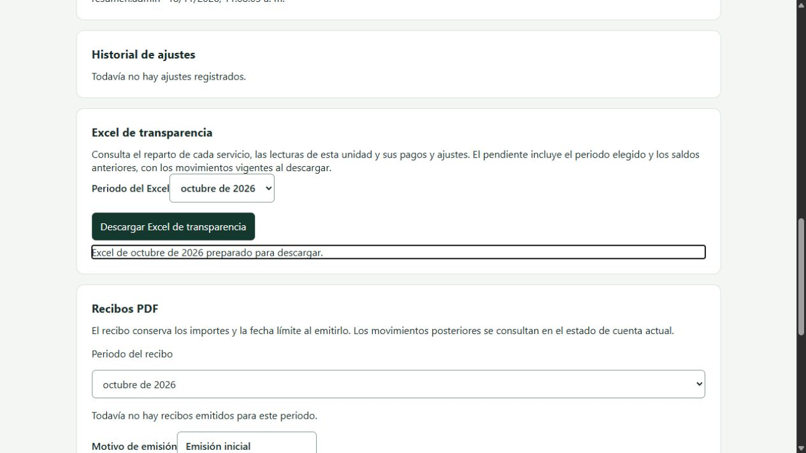

Verificación local del 18 de noviembre de 2026:

- Descargué desde el navegador como propietario para agosto y octubre, y como SuperAdmin para otra unidad. Comprobé la estructura del XLSX descargado y sus resultados: 0.00 pendiente para agosto de la unidad 001 y 163.33 para octubre de la unidad 002, incluido su pendiente anterior de 75.00.
- Recalculé las fórmulas del ejemplo con un lector independiente y comparé cada resultado con sus importes fuente. La búsqueda de errores no encontró referencias rotas ni divisiones inválidas. Una modificación temporal del ajuste actualizó el cargo derivado; esa copia de revisión no reemplaza el archivo descargado.
- Revisé las cinco hojas renderizadas, sus fechas, acentos, lecturas, cuotas teóricas y asignadas. El archivo conserva las cifras de origen y las fórmulas de conciliación. Las pruebas incluyen importe máximo y motivo de 500 caracteres, con filas ampliadas para textos largos.
- Activé la descarga con Enter y comprobé el foco en el aviso. Una respuesta demorada deshabilitó selector y botón durante la preparación. Un fallo sintético mostró el error; el reintento descargó el archivo.
- Revisé una pantalla de 390 × 844 sin desbordamiento horizontal. Una unidad sin cargos mostró el mensaje de vacío. Una segunda cuenta de propietario no pudo abrir la unidad de la primera. La API también cubre dos edificios, unidad ajena e inexistente, acceso administrativo y sesión cerrada.

La suite completa pasó con **156 pruebas** en PostgreSQL 17 aislado mediante `pytest -q`, incluidas veinte pruebas nuevas de exportación. `ruff check`, `ruff format --check`, `alembic check` y `npm run build` fueron correctos.

Para reproducir, crear una base aislada con `alembic upgrade head`, emitir cargos lineales y medidos, registrar pagos y ajustes y abrir el estado de cuenta de una unidad. Elegir un periodo en «Excel de transparencia», descargar y comparar Resumen, Cargos y Pagos con el estado de cuenta. Agregar una unidad después de emitir permite comprobar que Reparto conserva el divisor original.

Esta entrega no modifica el esquema ni usa S3. La verificación corresponde al entorno local; quedan pendientes la apertura en Microsoft Excel de escritorio y el recorrido con el backend y frontend desplegados.

## Recorrido del PDF consolidado mensual

El SuperAdmin descarga el consolidado desde Cobranzas, eligiendo un periodo con cargos. La [decisión del consolidado](decisiones/0006-pdf-consolidado-mensual.md) define los importes, las unidades incluidas y la lectura consistente.

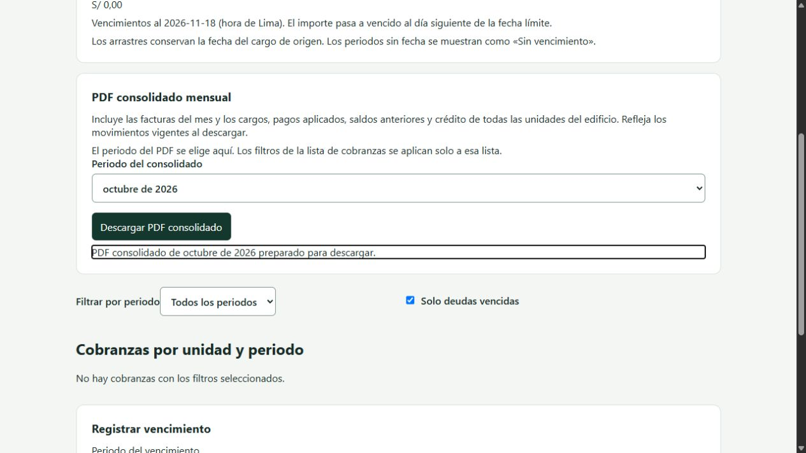

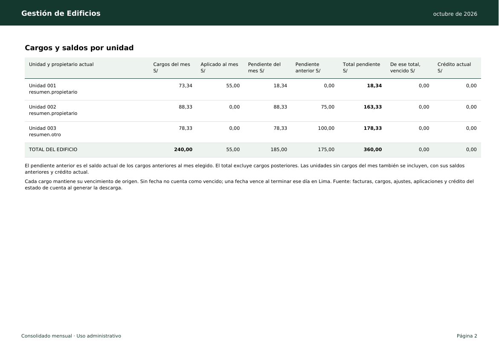

Verificación local del 18 de noviembre de 2026:

- El ejemplo de octubre tiene dos páginas A4 horizontales. La suma de sus tres unidades coincide con el pendiente de Cobranzas: 360.00, compuesto por 185.00 del mes y 175.00 anteriores. Sus servicios suman 240.00 de cargos y 55.00 aplicados al mes. El vencimiento del día de Lima todavía no se cuenta como vencido.
- Rendericé e inspeccioné todas las páginas del ejemplo y de un documento de estrés de cuatro páginas con nombres largos, acentos, símbolos e importes altos. Las tablas repiten encabezados y los importes conservan los céntimos en una sola línea. La prueba de 35 unidades comprueba que ningún importe individual o total quede partido.
- Descargué el PDF de octubre con Enter y comprobé su archivo, sus tres unidades y el pendiente de 360.00. La lista estaba filtrada por vencidos y vacía; el consolidado mantuvo todas las unidades. El aviso recibió foco.
- Cambié a agosto. Una demora sintética deshabilitó selector y botón. El error de descarga recibió foco y el reintento devolvió 200 con aviso de éxito. El cambio de periodo conserva su alcance independiente de los filtros de la lista.
- La vista de 390 × 844 no presentó desbordamiento horizontal. Un segundo edificio sin cargos mostró el mensaje de vacío y no ofreció descarga. El propietario fue redirigido a su portal al intentar abrir la ruta administrativa; la API denegó el consolidado a dos propietarios, incluso en sus edificios.

La suite completa pasó con **173 pruebas** en PostgreSQL 17 aislado, incluidas diecisiete del consolidado. Ruff, formato, `alembic check` y `npm run build` fueron correctos. Las pruebas comparan estados de cuenta, servicios, ajustes, liberaciones, crédito y vencimientos, y comprueban que un pago concurrente espere a terminar la lectura.

Para reproducir, emitir facturas en dos periodos de una base aislada, registrar pagos y ajustes y abrir Cobranzas. Elegir un periodo del consolidado, descargar y contrastar servicios y unidades con sus estados de cuenta. Repetir con un filtro de la lista activo y con otro edificio sin cargos.

La entrega no requiere migración, nuevas dependencias ni S3. Queda pendiente verificar el flujo en el entorno desplegado. No se aplicaron cambios en Neon ni en permisos de almacenamiento durante esta verificación.

## Recorrido de recibos por lote

La [decisión de lotes](decisiones/0007-recibos-por-lote.md) define la preparación y los resultados por unidad. La verificación local del 18 de noviembre de 2026 utilizó tres unidades de un edificio, dos propietarios, otro edificio y almacenamiento aislado.

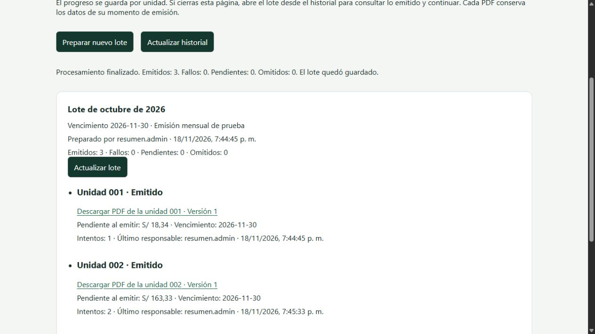

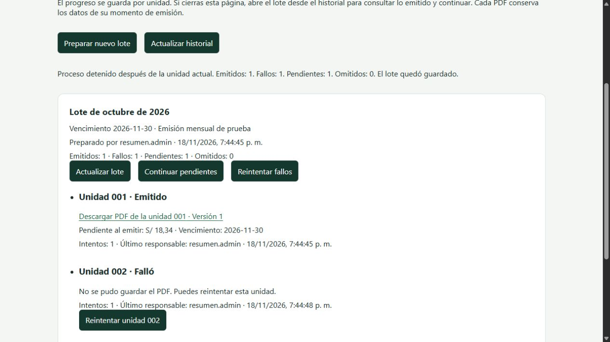

Desde Cobranzas abrí «Emitir recibos por lote», elegí octubre y cambié el vencimiento común al 30 de noviembre. Inicié la emisión con Enter. La pantalla mostró el progreso y deshabilitó las acciones incompatibles. Detuve el proceso después de la unidad en curso: quedaron un éxito, un fallo de almacenamiento y un pendiente.

Recargué la página y abrí el lote desde el historial. «Continuar pendientes» procesó solo la unidad pendiente. Al retirar el fallo sintético, «Reintentar fallos» completó la unidad fallida. El resultado final conservó los otros recibos: intentos 1, 2 y 1, con tres versiones iniciales y sin duplicados.

Preparé otro lote con motivo de regeneración. Simulé una respuesta perdida después de confirmar la primera unidad. La pantalla pidió actualizar; «Actualizar lote» recuperó el éxito guardado. Continuar emitió las otras dos unidades. La base conservó exactamente seis recibos: versiones 1 y 2 por cada unidad, con el vencimiento previsto. Las sumas de pendientes de cada lote coincidieron en 360.00 y las seis huellas SHA-256 coincidieron con los archivos aislados.

Comprobé el foco en avisos, una vista de 390 × 844 sin desbordamiento y el mensaje de edificio sin periodos con cargos. El propietario vio sus dos versiones individuales y fue redirigido a su portal al abrir la ruta administrativa. La API verificó dos propietarios, denegó recibos ajenos y devolvió la descarga autorizada con los mismos bytes del archivo guardado. Rendericé y revisé las dos páginas del recibo de ejemplo emitido desde el lote.

Retuve una tercera preparación con un bloqueo local y salí de la pantalla antes de recibir la respuesta. Al liberar el bloqueo, el lote quedó preparado con tres pendientes y cero intentos. Volví al historial y confirmé que salir durante la preparación no inició emisiones después: siguieron existiendo solo los seis recibos anteriores.

La suite completa pasó con **191 pruebas** en PostgreSQL 17 aislado: diecisiete de lotes y una de su migración, además de las existentes. Ruff, formato, `alembic check` y `npm run build` fueron correctos. Las pruebas concurrentes confirmaron una sola preparación y una sola emisión ante solicitudes simultáneas. El fallo de base después de crear un recibo revierte también su resultado del lote.

La prueba de migración sube desde 0015 con cargos, pagos, aplicaciones, vencimientos y un recibo previo; compara las tablas anteriores, comprueba las nuevas restricciones y protege el descenso con lotes.

El 18 de noviembre de 2026 apliqué `0016_receipt_batches` en Neon por conexión directa, después de generar un respaldo completo en formato personalizado y comprobar que su índice fuera legible. Las huellas y cantidades de las veinte tablas anteriores coincidieron antes y después. La base quedó con veintitrés tablas, las dos nuevas vacías y `alembic check` sin diferencias. Quedan pendientes el permiso S3 para `receipts/` y el recorrido del flujo desplegado; esta migración no escribió archivos ni modificó permisos de almacenamiento.

## Recorrido del Excel mensual del edificio

La [decisión del Excel mensual](decisiones/0008-excel-mensual-del-edificio.md) define el consolidado, la matriz de servicios y el detalle. La verificación local del 18 de noviembre de 2026 utilizó datos sintéticos con tres unidades, dos servicios, dos periodos, pagos parciales, un ajuste y un segundo edificio con crédito sin cargos.

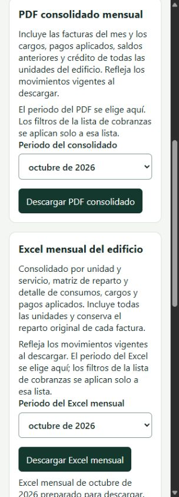

Desde Cobranzas descargué octubre con Enter y con «Solo deudas vencidas» activo. Aunque la lista estaba vacía, el archivo mantuvo las tres unidades y sus dos servicios. El aviso de éxito recibió foco y la descarga produjo un XLSX de tres hojas. Las pruebas compararon sus importes con los estados de cuenta y el PDF consolidado.

El ejemplo concilia 240.00 de cargos del mes, 55.00 aplicados, 185.00 pendientes del mes y 175.00 anteriores: 360.00 pendientes en total. La matriz concilia los 90.00 del agua y los 150.00 de mantenimiento; su diferencia de reparto es cero. El agua conserva 9.000 m³ de proveedor, 5.000 propios y 4.000 comunes, con tres unidades en el divisor.

Importé el ejemplo con un lector independiente, recalculé sus fórmulas y revisé visualmente las tres hojas. No aparecieron errores de fórmula. Cambiar temporalmente un ajuste de 0 a 5 en una copia en memoria elevó los cargos de 240.00 a 245.00 y el pendiente de 360.00 a 365.00. El archivo de ejemplo se conservó sin esa modificación.

Cambié a agosto. Una demora sintética deshabilitó el botón y el selector; el fallo de descarga mostró el aviso con foco. Tras retirar el fallo, el reintento descargó agosto correctamente. La vista de 390 × 844 no presentó desbordamiento horizontal. Otro edificio sin cargos mostró el mensaje de vacío. El propietario fue redirigido a su portal al abrir Cobranzas; la API denegó la descarga a dos propietarios y aisló los datos de ambos edificios.

La suite completa pasó con **205 pruebas** en PostgreSQL 17 aislado, incluidas catorce del Excel mensual. Después de los ajustes finales de presentación y rangos de ordenación se repitieron las **51 pruebas** de Excel mensual, transparencia y consolidado: todas aprobadas. Ruff, formato, `alembic check` y `npm run build` correctos. Los casos cubren 100.00 entre tres unidades, consumo común, lecturas con tres decimales y reinicio, unidades agregadas después, ajustes con liberaciones, crédito separado, corte por periodo, textos literales, permisos y bloqueo de un pago concurrente durante las cinco consultas.

Para reproducir, emitir servicios lineales y medidos en una base aislada, registrar pagos y ajustes y abrir Cobranzas. Elegir un periodo del Excel, descargar y contrastar unidades, servicios y saldos con el PDF y los estados de cuenta. Repetir con filtros activos, otro periodo y un edificio sin cargos.

Esta entrega no requiere migración ni nuevas dependencias y no modifica Neon ni S3. Quedan pendientes la apertura en Microsoft Excel de escritorio y el recorrido desplegado; la revisión de cálculo y presentación se realizó con el lector independiente.

## Recorrido del Excel histórico de cobranzas

La [decisión del histórico](decisiones/0009-excel-historico-de-cobranzas.md) define las hojas por periodo, los saldos anteriores y su conciliación. La verificación local del 18 de noviembre de 2026 utilizó un edificio de tres unidades, cargos de agosto y octubre, pagos y un ajuste, dos propietarios y otro edificio sin cargos con crédito disponible.

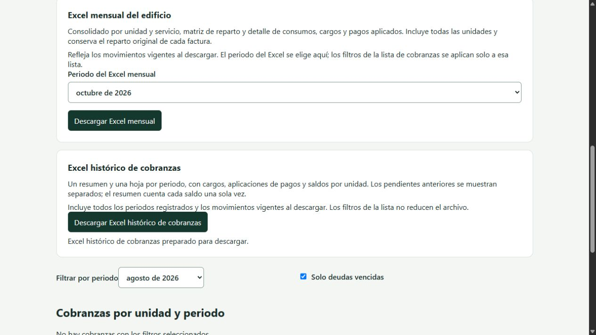

Desde Cobranzas seleccioné agosto y «Solo deudas vencidas», dejando vacía la lista. Descargué el histórico con Enter: el archivo mantuvo todos los periodos y las tres unidades, y el aviso de éxito recibió foco. El archivo descargado contiene Resumen, Periodo 2026-10 y Periodo 2026-08.

El resumen concilia 535.00 de cargos vigentes y 175.00 aplicados: pendiente total 360.00, igual que Cobranzas. Agosto conserva 295.00 de cargos, 120.00 aplicados y 175.00 pendientes. Octubre muestra 240.00, 55.00 y 185.00, respectivamente; agrega los 175.00 anteriores solo a su vista acumulada, que alcanza 360.00. El resumen suma 175.00 y 185.00, sin volver a sumar los anteriores.

Recalculé el archivo descargado con un lector independiente y revisé visualmente sus tres hojas; no aparecieron errores de fórmula. En una copia en memoria cambié el cargo de agosto de una unidad de 95.00 a 100.00. El pendiente del resumen y el acumulado de octubre aumentaron a 365.00: el cambio se contó una sola vez. Conservé el archivo original sin esa modificación.

Una demora sintética deshabilitó el botón. El error mostró un aviso con foco y, tras retirar el fallo, el reintento descargó el archivo correctamente. La vista de 390 × 844 no presentó desbordamiento horizontal. El edificio sin cargos mostró el estado vacío. El propietario fue redirigido a su portal al intentar abrir Cobranzas; la API denegó la descarga a dos propietarios y aisló los datos de ambos edificios.

La suite completa pasó con **218 pruebas** en PostgreSQL 17 aislado, incluidas trece del histórico. Tras los ajustes finales de presentación, se repitieron las **47 pruebas** de histórico, Excel mensual y transparencia: todas aprobadas. Ruff, formato, `alembic check` y `npm run build` correctos. Los casos cubren cambio de año, meses sin cargos, unidades con solo saldo anterior, crédito separado y consumo posterior, ajustes con liberaciones, importes cero, texto literal, permisos y bloqueo de un pago concurrente durante las cuatro consultas.

Para reproducir, emitir facturas en periodos separados y en dos años, registrar pagos y ajustes y abrir Cobranzas. Descargar el histórico y comparar el resumen con Cobranzas y cada acumulado con el Excel mensual. Repetir con filtros activos, un edificio sin cargos, un propietario y una falla de descarga.

No se aplicaron migraciones ni cambios en Neon o S3. Quedan pendientes Microsoft Excel de escritorio y el recorrido desplegado; la validación de fórmulas y presentación se realizó con el lector independiente.
